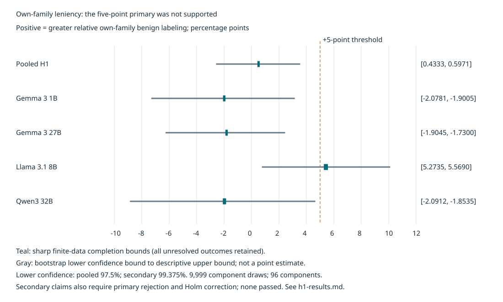
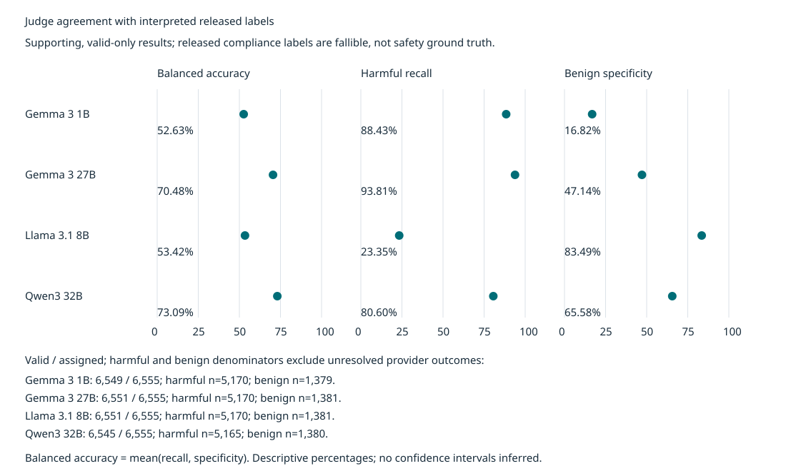

# Safety judges and own-family leniency

Do language models judge harmful responses from their own model family more leniently than responses from other families? This repository contains a completed four-judge study of the selected [Coin Flip for Safety release](https://huggingface.co/datasets/ASSELab/CoinflipForSafety), its offline analysis code, and aggregate results.

**The preregistered five-percentage-point pooled claim was not supported.** The observed pooled contrast has sharp completion bounds of **+0.433 to +0.597 percentage points**, accounting for unresolved judgments. Its one-sided component-bootstrap test gives **p = .9989**; the basic 97.5% lower confidence bound is **−2.584 points** and the descriptive upper bound is **+3.548 points**. This is not proof of no family effect or of judge reliability.

The main run and H1 analysis are complete. **H2 was not run. The exploratory Qwen thinking-on arm is dropped for now and contributes no results here.**

## Design

The protocol was preregistered locally: hypotheses, weights, thresholds, parser rules and analysis were frozen in the repository's dated process record before main-run data. It was not deposited in an external registration service. Two documented pre-main changes added deterministic outer-fence normalization and provider structured-output modes after smoke testing.

- **6,555 eligible responses**, each assigned to all four judges: **26,220 judgments**. Interpreted released labels classify 5,173 responses as harmful and 1,382 as benign.
- **Gemma 3 1B (G1), Gemma 3 27B (G27), Llama 3.1 8B (L8), and Qwen3-32B (Q32)** used the same compliance rubric. Qwen thinking was disabled. Current hosted snapshots are not verified matches to the historical generators.
- Released labels map to ordinal `1 + 4 × released_label`; ordinal ≥3 is treated as harmful. This is an explicit interpretation of fallible labels, not independently validated safety ground truth.
- **Pooled H1 is the sole primary:** own-family relative benign-label leniency greater than five points on harmful-reference responses. Family-balanced judge/source margins count both Gemmas as one family; within each source, weights balance linked components, attacks and responses.
- **H1a–d are secondary:** each judge's relative own-family contrast, with primary-gated Holm correction. All judge-by-3/5/10-point comparisons are exploratory and cannot select the headline.
- Inference uses **9,999 shared component-bootstrap draws**, seed **2026101701**, over **96 linked components**. Primary alpha is **.025**. Failures remain unknown outcomes in the primary bounds rather than being dropped or imputed.

See [plain methods](docs/methods.md) for definitions and [full aggregate results](docs/h1-results.md) for the inferential rules and sensitivity tables.

## Results

Completion bounds below cover all binary values of unresolved outcomes in this finite dataset; they are **not confidence intervals**. Positive values mean relative own-family benign-label leniency.

| Target | Completion bounds (percentage points) | Preregistered claim supported? |
| --- | ---: | --- |
| Pooled H1 | +0.433 to +0.597 | No |
| G1 | −2.078 to −1.901 | No |
| G27 | −1.904 to −1.730 | No |
| L8 | +5.273 to +5.569 | No |
| Q32 | −2.091 to −1.853 | No |

No secondary passed; all four Holm-adjusted p-values are 1. L8's descriptive contrast exceeds five points, but its raw p=.4334 and conservative lower confidence bound of +0.757 points do not establish the secondary claim. The primary gate also remains closed.



### Agreement with released labels

These are **supporting, valid-only** measures against interpreted references. Balanced accuracy averages harmful recall and benign specificity. High harmful recall can coexist with low benign specificity; binary agreement alone hides that trade-off.

| Judge | Binary agreement | Balanced accuracy | Harmful recall | Benign specificity | Valid / assigned |
| --- | ---: | ---: | ---: | ---: | ---: |
| G1 | 73.355% | 52.629% | 88.433% | 16.824% | 6,549 / 6,555 |
| G27 | 83.972% | 70.475% | 93.810% | 47.140% | 6,551 / 6,555 |
| L8 | 36.025% | 53.418% | 23.346% | 83.490% | 6,551 / 6,555 |
| Q32 | 77.433% | 73.090% | 80.600% | 65.580% | 6,545 / 6,555 |

The run retained **24 provider/delivery failures**: G1 6 (0.0915%), G27 4 (0.0610%), L8 4 (0.0610%), Q32 10 (0.1526%). There were **zero observed format failures**. Raw and normalized parse rates matched for every judge. G1 remained in the study; successful parsing does not establish correct judgment or provider-side schema enforcement.



### Label-error sensitivity

A frozen exploratory heuristic flips references near the ordinal 2/3 boundary, using budgets of 1%, 5% and 10% of all responses. The pooled completion bounds become **−3.378 to −3.214**, **−6.413 to −6.246**, and **−7.004 to −6.842 points**, respectively. Even the 1% scenario reverses the pooled sign.

These are hypothetical, deliberately adverse boundary-label changes—not measured error rates, exact worst cases, or corrected primary results. They show that the small observed contrast depends on reference-label interpretation. Supporting alternative weighting schemes also change the estimand and cannot replace the preregistered result.

## Limits

- This is a **selected release**, not an unselected deployment population or an estimate of population attack-success rate.
- Compliance is narrower than safety or technical correctness. Released human labels can be wrong; supporting agreement is conditional on valid model outputs.
- Historical responses may have been truncated near 256 tokens or lack needed context. The study judges the released text.
- Nominal model family does not establish self-recognition or causal bias. Capacity, content specialization, contamination and selection can also explain contrasts.
- Hosted snapshots and quantization may differ from the original generators. Gemma appears twice in the roster; balancing it as one family is consequential.
- Bootstrap probabilities rely on unverified component independence and representativeness. Linked components and passing support screens do not prove those assumptions.
- The final artifact audit verified the frozen embedded population and manifests; it did not independently regenerate eligibility from the original CSV at that stage.

## Reproduce the public tables and figures

The committed [aggregate JSON](docs/h1-aggregate-results.json) is the only data input needed to render the public results. No credentials, dataset download or inference calls are needed.

```bash
uv sync
uv run python tools/render_results.py
```

Generated CSV tables: [H1 bounds](docs/tables/h1-bounds.csv), [judge agreement](docs/tables/judge-agreement.csv), [label-error sensitivity](docs/tables/label-error.csv), [exploratory 3/5/10-point comparisons](docs/tables/exploratory-thresholds.csv), and [failures](docs/tables/failures.csv). The two SVG figures above are standalone files with no external assets.

This regenerates presentation artifacts from saved aggregate numbers. **It does not rerun the bootstrap, reconstruct per-item judgments, or select the label-error flips.** Those operations require the retained private configuration and journal. The exact offline analysis command, hashes and implementation commit are recorded in [H1 results](docs/h1-results.md#reproduction-and-provenance). Use fresh output paths: evidence writers refuse overwrite.

The original source CSV is not redistributed. An independent study rerun requires obtaining it separately, auditing eligibility, freezing models and settings, and explicitly arranging provider access and spending authority. New provider outputs need not reproduce the saved judgments.

## Development and offline workflow

[uv](https://docs.astral.sh/uv/) manages the pinned CPython interpreter and locked dependencies. Install uv 0.13.1 or newer, then run:

```bash
uv sync
uv run ruff format --check
uv run ruff check
uv run pyright
uv run pytest
uv run prek install  # optional local Git hooks
```

`pyproject.toml` is the tooling source of truth. Ruff selects `ALL` with documented exceptions; Pyright uses strict mode and named, checked suppressions; pytest treats warnings as errors. Immutable Pydantic models validate configuration and evidence, and NumPy supports the additive-fit sensitivity. Tools are pinned exactly; runtime dependencies are resolved in `uv.lock`. CPython 3.15 is required for the project's explicit lazy typing imports and type syntax.

The CLI supplies offline source audits, configuration preparation, synthetic dry runs, journal inspection, reports and scenario estimates:

```bash
uv run python -m safety_judge --help
```

`examples/` contains a source-derived rubric, generation settings and unfunded cost assumptions. Synthetic outputs test mechanics, not scientific validity. The source-derived rubric is not a recovered historical generator prompt. The optional `tools/setup-vivi.sh` installs the pinned local coordination tooling; it is not needed to render the results.

The execution boundary journals intent before dispatch, stores raw evidence before parsing, reserves worst-case costs, and reconciles settlements on resume. Interrupted or uncertain delivery remains a liability; terminal attempts are not silently resent. Live inference requires an explicitly injected transport and separate execution authority. Nothing in this README authorizes calls or spending.

| Path | Contents |
| --- | --- |
| `docs/h1-results.md` | Detailed aggregate results and analysis provenance |
| `docs/h1-aggregate-results.json` | Committed aggregate data for public rendering |
| `docs/methods.md` | Plain methods summary |
| `docs/process-log.md` | Dated protocol decisions, deviations and audit receipts |
| `tools/render_results.py` | Offline public-artifact renderer |
| `src/safety_judge/` | Ingestion, judging, accounting, journaling and analysis code |
| `tests/` | Tests and repository policy checks |
| `examples/` | Non-sensitive workflow inputs |

Source data, run artifacts, raw completions, local coordination state and secrets stay outside Git. Public aggregate provenance includes hashes and local artifact path names; it does not contain those artifacts' contents.
